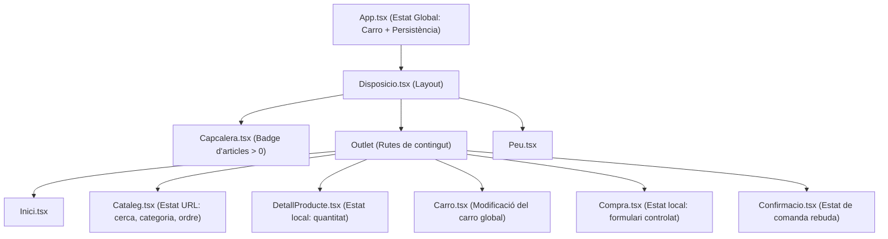

# Memòria Tècnica – PR1 · PratShop v1
**Mòdul 0488: Desenvolupament d'interfícies (DAM2)**  
**Projecte:** ActivePrat (Botiga d'equipament d'alt rendiment)  
**Estudiant:** Cognom1 Cognom2, Nom  
**Curs acadèmic:** 2025–2026  

---

## 1. Comparativa d'Eines de Disseny i Llibreries d'Interfície

### 1.1 Comparativa d'Eines de Disseny (Penpot vs. Google Stitch vs. Figma)

| Criteri Tècnic | Penpot | Google Stitch | Figma |
| :--- | :--- | :--- | :--- |
| **Model de Llicència** | Open Source (AGPLv3), gratuït i autoallotjable (*self-hosted*). | Propietari de Google Labs (accés per invitació/beta). | Freemium propietari comercial amb plans de pagament per equip. |
| **Generació de Codi** | Suport nadiu SVG/CSS basat en estàndards web W3C oberts. | Generació directa d'HTML/Tailwind assistida per IA segons prompts. | Requereix plugins o eines de Dev Mode (sovint sota subscripció). |
| **Sistema de Tokens** | Suport natiu complet per a Design Tokens (JSON segons W3C). | Tokens extrets en Markdown (`DESIGN.md`) i classes utilitàries. | Suport avançat mitjançant Variables i Tokens de disseny natius. |
| **Col·laboració i Ecosistema** | Basat en web, interfície moderna, comunitat en creixement actiu. | Enfocat a la iteració ràpida de conceptes i prototipatge amb IA. | Estàndard indiscutible de la indústria amb un ecosistema massiu de plugins. |
| **Integració amb el projecte** | Ideal per a projectes que exigeixen independència de proveïdor. | **Eina escollida com a font de partida per a la PR1 (ActivePrat)**. | Excel·lent per a equips multidisciplinaris de disseny corporatiu. |

### 1.2 Comparativa de Tecnologies d'Interfície (CSS Modules vs. Tailwind CSS vs. MUI)

| Criteri Tècnic | CSS Modules | Tailwind CSS | Material UI (MUI) |
| :--- | :--- | :--- | :--- |
| **Aïllament d'Estils (Scoping)** | **Nadiu i automàtic:** genera noms de classe únics en temps de compilació evitant col·lisions. | Global: depèn del compliment de classes utilitàries a l'HTML/JSX. | Encapsulat mitjançant CSS-in-JS (Emotion/Styled Components). |
| **Sobrecàrrega del Bundler (Bundle Size)** | **Lleugeríssim:** es compila a fitxers CSS plans sense runtime afegit. | Molt optimitzat en producció mitjançant purgatge automàtic de classes. | Pes elevat del runtime de JavaScript a causa del motor CSS-in-JS. |
| **Flexibilitat i Disseny Propi** | **Total:** control absolut de propietats CSS, selectors i variables `:root`. | Alta, però condicionada a la convenció de classes i configuració de Tailwind. | Limitada per les directrius visuals rígides de Material Design. |
| **Separació de Responsabilitats** | **Neta:** manté la lògica del component a `.tsx` i l'estil a `.module.css`. | Tota la definició d'estils s'acumula a l'atribut `className` del JSX. | Barreja propietats visuals com a props del component JSX. |
| **Compliment dels Requisits PR1** | **Escollit per al projecte:** permet traduir fidelment els tokens de Stitch sense dependències externes. | Descartat per mandat de la pràctica (no usar CDN ni utilitats globals). | Descartat per pes excessiu i incompatibilitat amb la identitat visual d'ActivePrat. |

---

## 2. Taula de Transformació de Codi Generat per Stitch

Aquesta taula documenta casos reals de transformació del codi generat per Google Stitch cap a la nostra implementació final en React 19 + TypeScript:

| # | Codi Generat per Stitch (HTML / Tailwind / Vanilla) | Què s'ha fet a l'App Final (React 19 + TypeScript) | Justificació Tècnica i Didàctica |
| :-: | :--- | :--- | :--- |
| **1** | `
` | `className={styles.targeta}` acompanyat de variables com `var(--color-surface)` i `var(--color-primary-container)` a `TargetaProducte.module.css`. | Elimina les classes utilitàries i els valors hexadecimals dispersos. Centralitza el disseny a `:root` d'`index.css`, garantint consistència i facilitant el canvi de tema (mode fosc/clar). |
| **2** | `` | Gràfics vectorials locals a `/public/img/hyperion-pro.svg` creats específicament amb gradient volt i fons nocturn. | Els enllaços d'imatges de Google Stitch caduquen ràpidament i depenen de connectivitat externa. Els fitxers SVG locals garanteixen càrrega immediata, pes mínim i fiabilitat permanent. |
| **3** | `<script>` amb lògica de cerca manual iterant sobre el DOM: `document.querySelectorAll('.card').forEach(...)` | Estat reactiu sincronitzat amb la URL mitjançant `useSearchParams()` de React Router (`/cataleg?cerca=...&categoria=...`). | L'enfocament vanilla manipula imperativament el DOM i trenca l'historial del navegador. Amb `useSearchParams`, l'estat és declaratiu, enllaçable (bookmarkable) i respecta el cicle de vida de React. |
| **4** | Botons estàtics amb estils en línia d'alçada i amplada fixa (`style="width: 280px; height: 48px;"`). | Component controlat `<SelectorQuantitat>` amb props immutables (`valor`, `minim`, `maxim`, `onCanvi`) i botó flexible `<Boto>`. | L'amplada fixa trencava la visualització en dispositius de 390px. Els components controlats garanteixen que no es pugui demanar una quantitat inferior a 1 ni superior a l'estoc real del magatzem. |

---

## 3. Decisions d'Ubicació de l'Estat (State Management)

L'arquitectura de l'estat segueix el principi de la menor elevació necessària (*lift state up* només quan és imprescindible):

1. **Cistella de la compra (`carro: LiniaCarro[]`)**:
   - **Ubicació:** Aixecat a `App.tsx`.
   - **Motiu:** Ha de ser accessible per la `Capcalera` (per renderitzar el badge d'articles), per la pàgina `DetallProducte` (per afegir unitats), per la pàgina `Carro` (per modificar o esborrar línies) i per la pàgina `Compra` (per buidar el carro en finalitzar).
2. **Subtotals i Totals**:
   - **Ubicació:** Valors **derivats** en temps de renderització a `Carro.tsx`, `Compra.tsx` i `Capcalera.tsx`.
   - **Motiu:** Mai s'emmagatzemen a l'estat per evitar inconsistències o desincronitzacions de dades.
3. **Cerca, Categories i Ordenació del Catàleg**:
   - **Ubicació:** Paràmetres de cerca de la URL (`useSearchParams`).
   - **Motiu:** Permet compartir enllaços directes amb filtres aplicats, permet a l'usuari utilitzar els botons d'avançar/retrocedir del navegador i manté el component `Cataleg` lliure d'estats volàtils redundants.
4. **Formulari de Tramitació de Compra (`DadesCompra`)**:
   - **Ubicació:** Estat local a `Compra.tsx`.
   - **Motiu:** Només té sentit mentre l'usuari omple les dades d'enviament; un cop validat, es genera la `Comanda` immutable que es transmet a `/confirmacio`.

---

## 4. Pla de Proves (Test Plan)

La suite de proves s'executa tant de manera automatitzada amb **Vitest** (`npm test`) com mitjançant verificacions manuals d'interfície:

| ID | Cas de Prova | Descripció i Acció | Tipus de Cas | Resultat Esperat | Resultat Obtingut | Estat |
| :-: | :--- | :--- | :-: | :--- | :--- | :-: |
| **CP01** | Límits del Selector de Quantitat | Clicar "-" quan el valor és 1, o clicar "+" fins a superar l'estoc. | **Límit** | El botó "-" queda deshabilitat a 1; el botó "+" queda deshabilitat quan el valor assoleix l'estoc màxim. | Valor protegit en el rang [1..estoc]. | **PASS** |
| **CP02** | Gestió de Producte Esgotat | Accedir a un producte amb `estoc = 0` (ex: Corró de Foam). | **Límit** | Imatge dessaturada, insígnia "Esgotat", preu desactivat i botó "Avisa'm quan estigui disponible" deshabilitat. | Visualització correcta i impossibilitat d'afegir al carro. | **PASS** |
| **CP03** | Redirecció per ID Desconegut | Escriure a la barra d'adreces `/producte/id-que-no-existeix`. | **Error** | Redirecció automàtica a la pàgina d'error 404 (`<Navigate to="/404" replace />`). | Es renderitza la pàgina 404 amb opció de tornar a l'inici. | **PASS** |
| **CP04** | Validació de Codi Postal | Introduir un codi postal de 4 dígits ('0882') o amb lletres ('0882A'). | **Error** | La funció pura `validar()` retorna l'error "El codi postal ha de tenir exactament 5 dígits." sota el camp. | Error mostrat en vermell; enviament bloquejat. | **PASS** |
| **CP05** | Accés a Compra amb Carro Buit | Navegar directament a la URL `/compra` sense cap article a la cistella. | **Error** | Redirecció automàtica a `/carro` indicant que no hi ha articles per tramitar. | Redirigit immediatament a `/carro`. | **PASS** |
| **CP06** | Resiliència de LocalStorage Corrupte | Inserir dades invàlides a `localStorage.setItem('pratshop_carro_v1', 'corrupt{json')` i recarregar. | **Error** | El bloc `try/catch` del *lazy initializer* captura l'excepció i retorna un carro buit `[]` sense trencar l'app. | L'aplicació arrenca perfectament amb carro a 0 unitats. | **PASS** |
| **CP07** | Cerca i Filtre Combinat al Catàleg | Filtrar per "Entrenament" i cercar "Titan". | **Funcional** | La URL s'actualitza a `?categoria=Entrenament&cerca=Titan`; el comptador indica "1 de 13 productes". | Graella filtrada amb èxit i reactivitat immediata. | **PASS** |
| **CP08** | Càlcul d'Enviament Gratuït | Afegir productes amb total < 50 € (avís de resta pendent); augmentar a ≥ 50 €. | **Funcional** | Quan el total és inferior a 50 €, es cobren 4,95 € d'enviament; a partir de 50 €, l'enviament passa a ser "Gratuït". | Banner dinàmic verd i despeses a 0,00 €. | **PASS** |

---

## 5. Declaració d'Ús d'Intel·ligència Artificial

En compliment de la normativa acadèmica del mòdul 0488:
- **Eines utilitzades:** Google Stitch (versió beta experimental de Google Labs) per a la generació del sistema de disseny visual i arxius HTML base; Antigravity (Google DeepMind) com a eina de pair programming intel·ligent.
- **Objectiu:** Aprofitar les capacitats d'aprenentatge automàtic per accelerar el disseny d'interfícies modernes i automatitzar tasques repetitives de transcripció de tokens i tipat TypeScript.
- **Aportació pròpia de l'estudiant:**
  - Presa de decisions d'arquitectura: elecció de CSS Modules per davant de frameworks globals.
  - Implementació de la gestió d'estat aixecat immutable i derivació matemàtica de totals.
  - Creació de funcions pures de validació de formularis i manipulació de dades.
  - Traducció acurada i adaptació al marc cultural i lingüístic català.
  - Disseny i execució del pla de proves amb Vitest.
